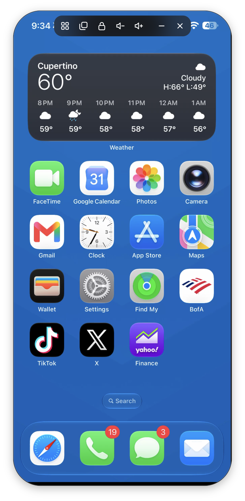

# controlmyiphone: mirror and control your iPhone from Windows or Mac

**See your iPhone's screen live on your PC and control it with your mouse and keyboard, for free.** Plug it in (or use over Wi-Fi), and the screen shows up at up to 60 frames per second in full resolution. Click to tap, drag to swipe, scroll with your mouse wheel, and type with your keyboard. No jailbreak needed. No install on IPhone needed.

<p>
  <a href="https://github.com/meekwilliam/controlmyiphone/releases/latest/download/controlmyiphone.exe"></a>
</p>

[](https://github.com/meekwilliam/controlmyiphone/releases/latest)
[](https://github.com/meekwilliam/controlmyiphone/releases)
[](LICENSE)




## Features

- **Mirror your iPhone screen to your PC** live, in full resolution, at up to 60 fps over USB.
- **Control your iPhone from your computer:** click to tap, drag to swipe, Home, Lock and volume buttons.
- **Type on your iPhone with your keyboard,** and paste text from your PC.
- **Works over USB or Wi-Fi.**
- **No jailbreak, no app on the iPhone,** and no Xcode, Python or command line.

## Requirements

-  iPhone on **iOS 27 or newer**, with **Developer Mode** on (Settings › Privacy & Security › Developer Mode).
- **Windows 10 or 11** with [**Apple Devices**](https://apps.microsoft.com/detail/9np83lwlpz9k) from the Microsoft Store, which gives Windows the iPhone driver.

## Install

**Windows:** [Download `controlmyiphone.exe`](https://github.com/meekwilliam/controlmyiphone/releases/latest/download/controlmyiphone.exe) and run it. SmartScreen may warn that it's unrecognized, because it isn't code-signed. Choose **More info › Run anyway**.

## Use

1. Connect your iPhone, unlock, than tap **Trust** if asked.
2. The screen appears in the window.
3. Click to tap, drag to swipe, and use the buttons for Home, Lock and volume.

## How it works

It uses the same screen sharing as Apple's Xcode 27 Device Hub: the iPhone sends its screen as H.264 video through Apple's developer tunnel and takes touches and key presses back the same way. The engine is written in Rust on [idevice](https://github.com/jkcoxson/idevice), the window is [Tauri](https://tauri.app).

## Build from source

```bash
cd app
cargo build --release
```

The app is `app/target/release/controlmyiphone` (`.exe` on Windows).

## License

MIT. Not affiliated with Apple. iPhone is a trademark of Apple Inc.
